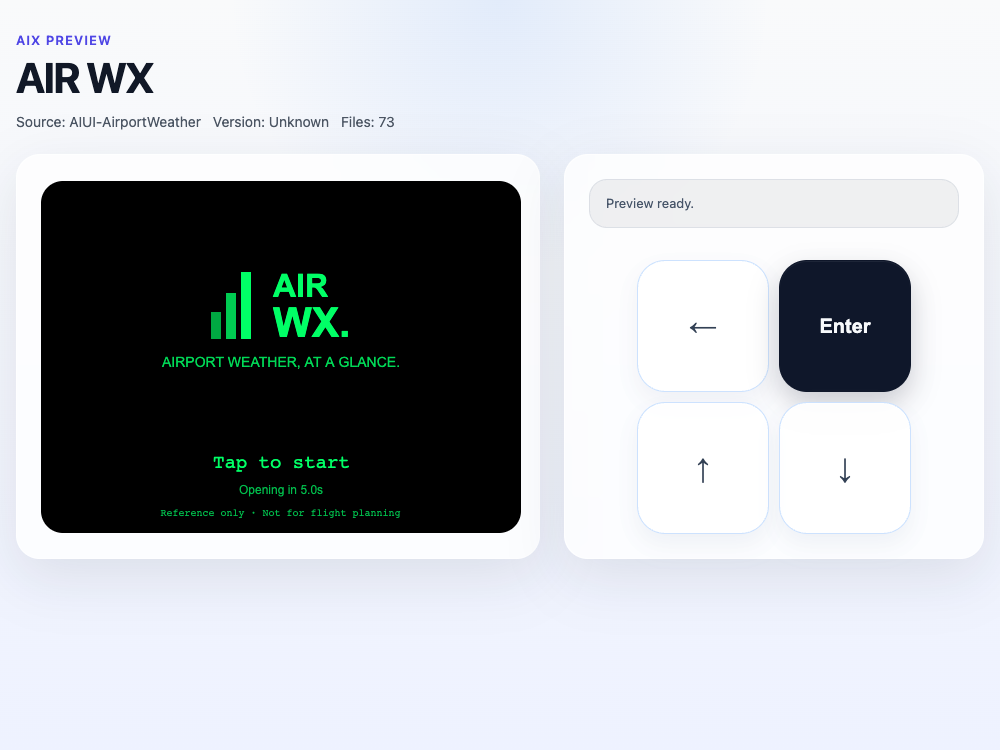

# AIR WX

AIR WX is a Rokid AIUI 0.17 airport weather viewer. It puts the original METAR
report in front of you and can add the optional TAF forecast. Use Nearby for
the closest METAR stations within 75 NM, or configure two custom ICAO lists.



English is the default interface. Japanese, Korean and Chinese can be selected
in Setup. The splash cover follows the G2-style black/green treatment: tap or
press Enter to start, or wait five visible focused seconds.

The app depends on the network and Nearby depends on one-shot location access.
It uses the public NOAA AviationWeather.gov data service. Raw reports remain in
their professional short format and are paged without translation or omission.
This is an information viewer. It cannot replace approved aviation weather,
flight briefing or operational systems.

## Development

```sh
npm test
npm run validate
npm run pack
```

Import the repository root into AIUI Studio. Target version is AIUI 0.17.0;
use `_blank` (480 × 352) when available, with `_current` layouts included.

Repository: https://github.com/BreezeLife/AIUI-AirportWeather  
AIUI project directory: `/`  
Reference: [even-g2-aviation-weather](https://github.com/MrMartellato/even-g2-aviation-weather)
